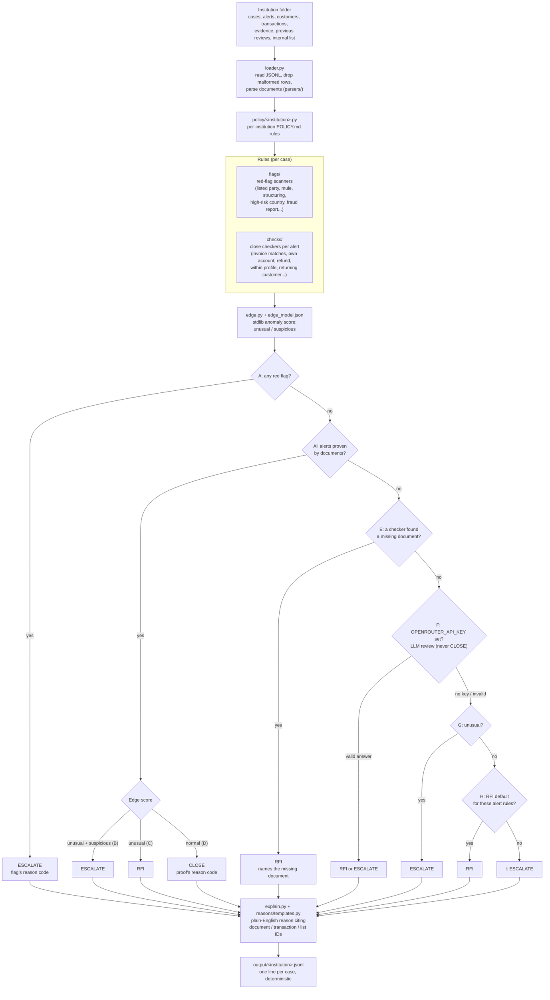

# fincrime-ci: AML alert triage (Track 1 submission)

Deterministic, rules-first triage engine for transaction-monitoring alerts. Every CLOSE is proven by documents on file per each institution's POLICY.md; anything unproven becomes an RFI that names the missing document, and red flags always escalate.

- `system/run <institution_folder> <output_file>`: entrypoint (Python 3 standard library only). See `system/README.md` for how it decides, runtime and cost.
- `output/{bank,emoney,investment,payments_fx}.jsonl`: outputs on the development data.

Dev-set results (organiser cost matrix): total cost 174 against 7,800 for escalate-everything (97.8% saved), 0 wrongful closes, verdicts identical across runs.

Optional LLM review: when `OPENROUTER_API_KEY` is set, cases no rule settles are reviewed by an LLM via OpenRouter (temperature 0, cached, validated; it can only choose RFI or ESCALATE, never CLOSE). Without a key the output is identical to `output/`. See `system/README.md`.

## Architecture

Red flags always win, a CLOSE needs every alert proven by documents on file, and anything unsettled falls to RFI or ESCALATE. Any crash on a case also falls back to ESCALATE, so the engine never closes when unsure.
